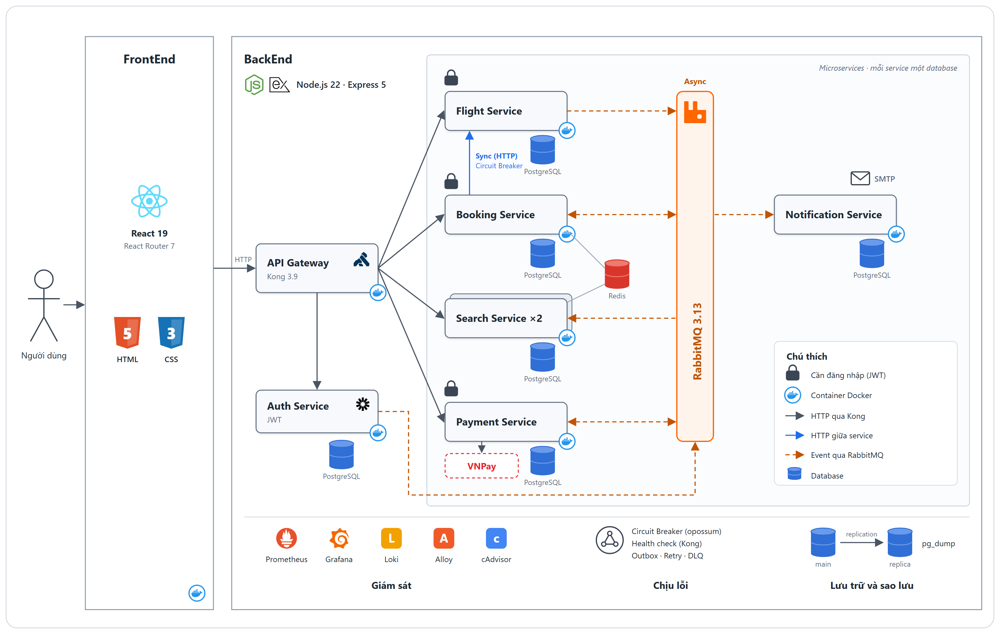

# SkyBook

Hệ thống đặt vé máy bay theo kiến trúc microservice, làm đồ án môn Hệ thống phân tán.

Người dùng tìm chuyến bay, chọn ghế, giữ chỗ 10 phút, thanh toán (VNPay sandbox hoặc cổng giả lập) và
nhận email xác nhận. Phía sau là 6 service Node.js, một API gateway, hàng đợi thông điệp, hai cụm
PostgreSQL có bản sao, cùng bộ công cụ giám sát. Tất cả chạy bằng một lệnh Docker Compose.

## Nội dung

1. [Chạy thử](#1-chạy-thử)
2. [Kiến trúc](#2-kiến-trúc)
3. [Luồng đặt vé](#3-luồng-đặt-vé)
4. [Các kỹ thuật phân tán](#4-các-kỹ-thuật-phân-tán)
5. [API](#5-api)
6. [Event](#6-event)
7. [Cấu hình](#7-cấu-hình)
8. [Tích hợp tùy chọn: email và VNPay](#8-tích-hợp-tùy-chọn-email-và-vnpay)
9. [Thử chịu lỗi](#9-thử-chịu-lỗi)
10. [Vận hành: giám sát, sao lưu, failover](#10-vận-hành-giám-sát-sao-lưu-failover)
11. [Cấu trúc mã nguồn](#11-cấu-trúc-mã-nguồn)
12. [Hạn chế](#12-hạn-chế)

## 1. Chạy thử

Cần Docker Desktop, cấp tối thiểu 4 GB RAM.

```bash
docker compose up -d --build   # lần đầu mất vài phút
docker compose ps              # chờ các container báo healthy
```

Khoảng 1 phút sau khi khởi động, Flight tự sinh dữ liệu mẫu: 8 chặng bay, 12 chuyến mỗi chặng mỗi ngày,
trong 30 ngày tới (2.880 chuyến). Mỗi lần khởi động lại, Flight bổ sung các ngày còn thiếu và không
đụng tới vé đã đặt.

| Trang | Địa chỉ | Đăng nhập |
| --- | --- | --- |
| Website và API | http://localhost:8000 | Tự đăng ký |
| Grafana | http://localhost:3000 | `admin` / `admin` |
| Prometheus | http://localhost:9090 | |
| RabbitMQ Management | http://localhost:15672 | `guest` / `guest` |

Tài khoản quản trị (dùng cho API tạo và sửa chuyến bay): `admin@flight.local` / `admin123`.

Khi chưa cấu hình VNPay, thanh toán dùng cổng giả lập và luôn thành công. Muốn thử nhánh thất bại, gọi
`POST /api/payments` với `cardNumber` có 4 số cuối là `0000`.

Dừng hệ thống:

```bash
docker compose down      # giữ dữ liệu
docker compose down -v   # xóa cả dữ liệu
```

## 2. Kiến trúc



```text
                           ┌─ /             ─► frontend (nginx, React build sẵn)
                           ├─ /api/auth     ─► auth
Trình duyệt ─► Kong :8000 ─┼─ /api/flights  ─► flight
                           ├─ /api/search   ─► search-1 │ search-2   (round-robin)
                           ├─ /api/bookings ─► booking ──HTTP──► flight
                           └─ /api/payments ─► payment ──► VNPay / cổng giả lập

auth, flight, booking, payment ──outbox──► RabbitMQ ──► search, booking, payment, notification

postgres-main    ─replication─► postgres-replica           (auth, flight, search, payment, notification)
postgres-booking ─replication─► postgres-booking-replica   (booking)
redis: cache của search, khóa ghế của booking
```

Kong là cổng vào duy nhất (port 8000). Website và API dùng chung một origin. Các service, database và
hàng đợi đều nằm trong mạng Docker nội bộ, không mở port ra ngoài.

| Service | Làm gì | Lưu ở đâu |
| --- | --- | --- |
| `auth` | Đăng ký, đăng nhập, cấp JWT, hồ sơ, ảnh đại diện, đổi mật khẩu | DB `auth` |
| `flight` | Chuyến bay và giá, là nguồn dữ liệu gốc | DB `flight` |
| `search` (2 bản) | Tìm kiếm và gợi ý trên bản sao dữ liệu chuyến bay (CQRS) | DB `search`, cache Redis 15 giây |
| `booking` | Giữ ghế, chống bán trùng, điều phối saga, hủy vé quá hạn | DB `booking` trên instance riêng, khóa Redis |
| `payment` | Thanh toán, nhận kết quả VNPay, hoàn tiền | DB `payment` |
| `notification` | Gửi email khi có event | DB `notification` |

| Lớp | Công nghệ |
| --- | --- |
| Frontend | React 19, React Router 7, Vite 7, nginx |
| Gateway | Kong 3.9, chế độ DB-less, cấu hình trong [kong/kong.yml](kong/kong.yml) |
| Service | Node.js 22, Express 5, pg, amqplib, redis, opossum, pino, prom-client |
| Dữ liệu | PostgreSQL 16, Redis 7, RabbitMQ 3.13 |
| Giám sát | Prometheus, Grafana, Loki, Alloy, cAdvisor, exporter cho PostgreSQL và Redis |

## 3. Luồng đặt vé

```text
1. Search    người dùng tìm chuyến (đọc read model của search, có cache Redis)
2. Booking   POST /api/bookings + Idempotency-Key
             ├─ key đã dùng thì trả lại vé cũ
             ├─ khóa ghế bằng Redis SET NX, ai chậm hơn nhận 409
             ├─ gọi flight lấy giá và giờ bay (qua circuit breaker)
             └─ ghi vé PENDING + event booking.created trong một transaction
                (unique index uq_active_seat chặn lần cuối)
3. Payment   POST /api/payments ─► VNPay hoặc cổng giả lập
             └─ ghi kết quả + event payment.succeeded / payment.failed
4. Booking   nhận event ─► vé CONFIRMED (hoặc CANCELLED) ─► event booking.confirmed
5. Notify    notification nhận event ─► gửi email xác nhận
```

Nếu không thanh toán trong 10 phút, job của Booking hủy vé và nhả ghế. Nếu tiền về sau khi vé đã bị
hủy, Booking phát `payment.refund_requested` để Payment hoàn tiền.

## 4. Các kỹ thuật phân tán

| Kỹ thuật | Cách làm | Giải quyết vấn đề gì |
| --- | --- | --- |
| API gateway | Kong định tuyến, kiểm tra JWT, giới hạn 6.000 request/phút, gắn `X-Correlation-ID` | Một điểm vào, bảo vệ và truy vết request |
| Cân bằng tải | Kong chia round-robin cho `search-1`, `search-2`, health check chủ động và bị động | Một bản chết thì bản kia nhận tải |
| Database riêng cho từng service | Mỗi service một database, không đọc chéo | Service độc lập về dữ liệu |
| Transactional outbox | Dữ liệu và event ghi chung một transaction; tiến trình nền đẩy lên RabbitMQ mỗi 500 ms | Không mất event khi RabbitMQ chết |
| Xử lý event idempotent | Bên nhận lưu `event_id` vào `processed_events` | Event giao lặp không bị xử lý hai lần |
| Dead letter queue | Event lỗi được xử lý tối đa 3 lần rồi chuyển vào `<queue>.dlq` | Event hỏng không chặn hàng đợi |
| Saga (choreography) | Booking và Payment phối hợp qua event, có bước bù trừ (hủy vé, hoàn tiền) | Giao dịch trải trên nhiều service |
| CQRS | Search giữ bản đọc riêng, cập nhật từ event của Flight và Booking | Tách tải đọc khỏi tải ghi |
| Chống bán trùng ghế | Khóa Redis `SET NX` + unique index `uq_active_seat` + `Idempotency-Key` | Nhiều người cùng tranh một ghế |
| Circuit breaker | opossum bọc lời gọi Booking → Flight và Payment → cổng thanh toán | Trả `503` ngay thay vì treo khi phụ thuộc chết |
| Nhân bản database | Streaming replication cho cả 2 instance, failover bằng script | Mất database chính vẫn khôi phục được |
| Tách instance theo tải | Booking (ghi nhiều nhất) chạy trên `postgres-booking` riêng | Sự cố một instance không kéo theo instance kia |

## 5. API

Mọi request đi qua `http://localhost:8000`. Route có cột JWT cần header `Authorization: Bearer <token>`,
token lấy từ `POST /api/auth/login`.

| Method | Đường dẫn | JWT | Mô tả |
| --- | --- | --- | --- |
| `POST` | `/api/auth/register` | | Đăng ký |
| `POST` | `/api/auth/login` | | Đăng nhập, trả JWT |
| `GET`, `PATCH` | `/api/auth/me` | Có | Xem, sửa hồ sơ |
| `PUT`, `DELETE` | `/api/auth/me/avatar` | Có | Đặt, xóa ảnh đại diện |
| `POST` | `/api/auth/me/password` | Có | Đổi mật khẩu |
| `GET` | `/api/flights/:id` | | Chi tiết chuyến bay |
| `POST` | `/api/flights` | Admin | Tạo chuyến bay |
| `PATCH` | `/api/flights/:id` | Admin | Sửa giá, giờ bay |
| `GET` | `/api/search?origin=&destination=&date=&sort=&maxPrice=&airline=` | | Tìm chuyến bay |
| `GET` | `/api/search/suggestions` | | Chuyến sắp khởi hành |
| `GET` | `/api/search/airports` | | Danh sách sân bay |
| `POST` | `/api/bookings` | Có | Giữ ghế, bắt buộc header `Idempotency-Key` |
| `GET` | `/api/bookings` | Có | Vé của tôi |
| `GET` | `/api/bookings/:id` | Có | Chi tiết vé |
| `GET` | `/api/bookings/flights/:flightId/seats` | Có | Sơ đồ ghế |
| `POST` | `/api/payments` | Có | Thanh toán một vé; với VNPay trả `{ payUrl }` |
| `GET` | `/api/payments/:bookingId` | Có | Trạng thái thanh toán |
| `GET` | `/api/payments/vnpay/return` | | VNPay đưa trình duyệt quay về, Payment kiểm tra chữ ký |
| `GET` | `/api/payments/vnpay/ipn` | | VNPay báo kết quả trực tiếp (cần địa chỉ public) |

Mỗi service còn có `/health/live`, `/health/ready`, `/metrics`, chỉ gọi được trong mạng Docker.

## 6. Event

Event đi qua topic exchange `events` của RabbitMQ; mỗi service nghe trên queue `<service>.events`.

| Event | Phát bởi | Nhận bởi |
| --- | --- | --- |
| `user.registered` | Auth | Notification |
| `user.password_changed` | Auth | Notification |
| `flight.updated` | Flight | Search, Booking |
| `booking.created` | Booking | Search, Payment |
| `booking.confirmed` | Booking | Notification |
| `booking.cancelled` | Booking | Search, Notification |
| `payment.succeeded` | Payment | Booking |
| `payment.failed` | Payment | Booking |
| `payment.refund_requested` | Booking | Payment |

## 7. Cấu hình

[docker-compose.yml](docker-compose.yml) đã có sẵn giá trị mặc định cho môi trường phát triển. Muốn
đổi, sao chép [.env.example](.env.example) thành `.env` rồi sửa.

| Biến | Mặc định | Ý nghĩa |
| --- | --- | --- |
| `POSTGRES_PASSWORD` | `postgres` | Mật khẩu PostgreSQL |
| `REPLICATOR_PASSWORD` | `replicator` | Mật khẩu user replication |
| `GRAFANA_PASSWORD` | `admin` | Mật khẩu Grafana |
| `JWT_SECRET` | `dev-only-change-me-...` | Khóa ký JWT, **phải trùng `consumers.jwt_secrets.secret` trong [kong/kong.yml](kong/kong.yml)**, nếu không mọi route cần đăng nhập trả `401` |
| `GATEWAY_FAIL_RATE` | `0` | Tỉ lệ (0 đến 1) lời gọi cổng thanh toán giả lập bị lỗi |
| `VNPAY_TMN_CODE`, `VNPAY_HASH_SECRET` | (trống) | Terminal VNPay sandbox; thiếu một trong hai thì dùng cổng giả lập |
| `VNPAY_RETURN_URL` | `http://localhost:8000/payment/vnpay-return` | Trang VNPay đưa trình duyệt về, phải là địa chỉ bạn mở website |
| `MAIL_RELAY_HOST` | (trống) | Máy chủ SMTP; trống thì không gửi email |
| `MAIL_RELAY_PORT` | `587` | Cổng SMTP |
| `MAIL_RELAY_USER`, `MAIL_RELAY_PASS` | (trống) | Tài khoản SMTP |
| `POSTGRES_HOST`, `BOOKING_DB_HOST` | (trống) | Do script failover ghi, không sửa tay |

Các mật khẩu mặc định chỉ dành cho môi trường phát triển.

## 8. Tích hợp tùy chọn: email và VNPay

### Email

Mặc định Notification chỉ ghi log `email skipped`. Để gửi thật, ví dụ qua Gmail:

1. Bật xác minh 2 bước, tạo App Password tại https://myaccount.google.com/apppasswords.
2. Điền vào `.env`:

   ```env
   MAIL_RELAY_HOST=smtp.gmail.com
   MAIL_RELAY_PORT=587
   MAIL_RELAY_USER=<địa chỉ Gmail>
   MAIL_RELAY_PASS=<App Password 16 ký tự, viết liền>
   ```

3. `docker compose up -d --no-deps notification`

Địa chỉ đuôi `.local` luôn bị bỏ qua. Gửi lỗi thì event vào `notification.events.dlq`; đăng ký và đặt
vé vẫn thành công.

### VNPay sandbox

1. Đăng ký terminal test tại https://pay.vnpaytest.vn/dev-registration để nhận `vnp_TmnCode` và
   `vnp_HashSecret`.
2. Điền `VNPAY_TMN_CODE` và `VNPAY_HASH_SECRET` vào `.env`, chạy
   `docker compose up -d --no-deps payment`. Log có `"provider":"vnpay"` là đã bật.
3. Đặt vé, bấm **Thanh toán**, chọn thẻ nội địa, ngân hàng NCB:

   | Trường | Giá trị |
   | --- | --- |
   | Số thẻ | `9704198526191432198` |
   | Tên chủ thẻ | `NGUYEN VAN A` |
   | Ngày phát hành | `07/15` |
   | OTP | `123456` |

```text
Checkout ─POST /api/payments─► Payment ký URL (HMAC-SHA512) ─► trình duyệt sang VNPay
VNPay ─► /payment/vnpay-return ─► GET /api/payments/vnpay/return ─► kiểm tra chữ ký và số tiền
      ─► payment.succeeded ─► Booking xác nhận vé
```

- Hủy hoặc lỗi trên VNPay thì vé vẫn `PENDING`, thanh toán lại được trong 10 phút giữ ghế.
- Kết quả từ trang return và IPN chỉ được ghi một lần, dù tới bao nhiêu lần và theo thứ tự nào.
- Chạy ở `localhost` thì VNPay không gọi được IPN; kết quả được ghi qua trang return.
- Lỗi `71` hoặc `88` từ VNPay nghĩa là terminal chưa được kích hoạt, không phải lỗi code. Liên hệ
  hotrovnpay@vnpay.vn.

## 9. Thử chịu lỗi

Mở dashboard "Tổng quan hệ thống đặt vé" trong Grafana, vừa dùng website vừa gây sự cố:

| Sự cố | Lệnh | Kết quả mong đợi |
| --- | --- | --- |
| Một bản Search chết | `docker stop search-1` | Kong chuyển hết sang `search-2`; `docker start search-1` thì bản này quay lại trong khoảng 45 giây |
| Redis chết | `docker stop redis` | Search đọc thẳng database; vẫn không bán trùng ghế |
| RabbitMQ chết | `docker stop rabbitmq` | Vẫn đặt được vé; event được gửi bù khi RabbitMQ chạy lại |
| Flight chết | `docker stop flight` | Đặt vé trả `503` ngay nhờ circuit breaker; xem ghế vẫn được |
| Cổng thanh toán lỗi | `GATEWAY_FAIL_RATE=1 docker compose up -d --no-deps payment` | Thanh toán trả `503`; vé giữ `PENDING` để thử lại |
| Database chính chết | `docker stop postgres-main` hoặc `postgres-booking` | Chỉ service dùng instance đó bị ảnh hưởng; chạy failover ở [mục 10](#failover-và-failback) |

Trên PowerShell, đặt biến bằng `$env:GATEWAY_FAIL_RATE = "1"` trước lệnh `docker compose`.

## 10. Vận hành: giám sát, sao lưu, failover

### Giám sát

| Muốn xem | Ở đâu |
| --- | --- |
| Sức khỏe, lưu lượng, lỗi, CPU, RAM, log | Grafana > Dashboards > Flight Booking > Tổng quan hệ thống đặt vé |
| Cảnh báo | Grafana > Alerting > Alert rules |
| Log theo service hoặc correlation ID | Grafana > Explore > Loki, ví dụ `{service="booking"}` |
| Target đang được thu metric | Prometheus > Status > Target health |
| Queue, event tồn, dead letter queue | RabbitMQ Management > Queues and Streams |

Log trực tiếp: `docker compose logs -f <service>`.

### Sao lưu và khôi phục

Container `backup` chạy `pg_dump` lúc 00:00 giờ Việt Nam mỗi ngày, giữ 7 bản gần nhất trong `backups/`.
Lần nào Docker không chạy đúng giờ thì bị bỏ qua. Mỗi instance được dump từ bản sao; bản sao không chạy
thì dump từ database chính.

```bash
docker compose exec backup sh /scripts/backup.sh                            # sao lưu ngay
docker compose exec backup sh /scripts/restore.sh 20261031-020000 booking   # khôi phục một DB
```

Trước khi khôi phục, dừng các service đang ghi vào database đó. `restore.sh` tự chọn instance theo tên
database.

### Failover và failback

Hai instance PostgreSQL failover độc lập:

| `-Cluster` | Chính | Bản sao | Biến trong `.env` | Service |
| --- | --- | --- | --- | --- |
| `main` (mặc định) | `postgres-main` | `postgres-replica` | `POSTGRES_HOST` | auth, flight, search, payment, notification |
| `booking` | `postgres-booking` | `postgres-booking-replica` | `BOOKING_DB_HOST` | booking |

```powershell
# Chuyển sang bản sao (khoảng 20 giây)
powershell -ExecutionPolicy Bypass -File scripts\failover.ps1 [-Cluster booking]

# Đưa database chính về và dựng lại bản sao (khoảng 1 phút)
powershell -ExecutionPolicy Bypass -File scripts\failback.ps1 [-Cluster booking]
```

- **failover.ps1:** dừng service và database chính, promote bản sao, ghi biến host vào `.env`, khởi
  động lại service, chờ Kong định tuyến được.
- **failback.ps1:** dừng service, sao lưu dữ liệu mới nhất từ bản sao, khôi phục vào database chính,
  dựng lại bản sao, xóa biến host khỏi `.env`, khởi động lại service.

Sau failover, hệ thống không tự quay về database chính vì dữ liệu ở đó đã cũ, và lúc này không còn bản
sao dự phòng. Hãy chạy failback khi database chính sẵn sàng. Không xóa tay `POSTGRES_HOST` hay
`BOOKING_DB_HOST` trong `.env` khi đang failover. Mỗi lần failback tạo thêm một bản sao lưu, tính vào
giới hạn 7 bản.

## 11. Cấu trúc mã nguồn

```text
.
├── docker-compose.yml    Toàn bộ hệ thống
├── .env.example          Mẫu biến môi trường
├── kong/kong.yml         Route, upstream, health check, JWT, rate limit
├── services/             npm workspace của backend
│   ├── Dockerfile        Dùng chung, chọn service qua build arg SERVICE
│   ├── common/           Thư viện chung: log, metric, outbox, RabbitMQ, Redis, breaker, JWT, health
│   └── auth/ flight/ search/ booking/ payment/ notification/
├── frontend/             React + Vite, build ra file tĩnh cho nginx
├── db/
│   ├── main/             Schema 5 database trên postgres-main, cấu hình replication
│   ├── booking/          Schema database booking, cấu hình replication
│   └── replica/          Script khởi động bản sao (dùng cho cả 2 cụm)
├── monitoring/           Prometheus, Grafana, Alloy
├── scripts/              backup, restore, failover, failback
├── backups/              Bản sao lưu
└── docs/                 Sơ đồ kiến trúc
```

Sửa giao diện với hot reload (backend vẫn chạy trong Docker, Vite chuyển `/api` sang Kong):

```bash
cd frontend && npm install && npm run dev
```

## 12. Hạn chế

- Kong, Redis, RabbitMQ và Booking chỉ có 1 bản. Kong chết thì cả hệ thống dừng; Booking chết thì
  không đặt được vé.
- 5 database dùng chung `postgres-main`. Instance này chết thì auth, flight, search, payment và
  notification dừng tới khi failover xong. Booking vẫn xem được vé cũ nhưng không đặt được vé mới vì
  cần gọi Flight.
- Failover phải chạy script bằng tay, chưa tự động. Chưa có auto-scaling.
- Chỉ chạy HTTP; muốn HTTPS cần thêm chứng chỉ cho Kong.
- Sau khi rebuild một service, Kong có thể trả `503` vài giây cho tới khi phân giải được IP mới.
- Chưa xác minh email khi đăng ký. Hoàn tiền VNPay chỉ đổi trạng thái trong database, không gọi API
  hoàn tiền.
