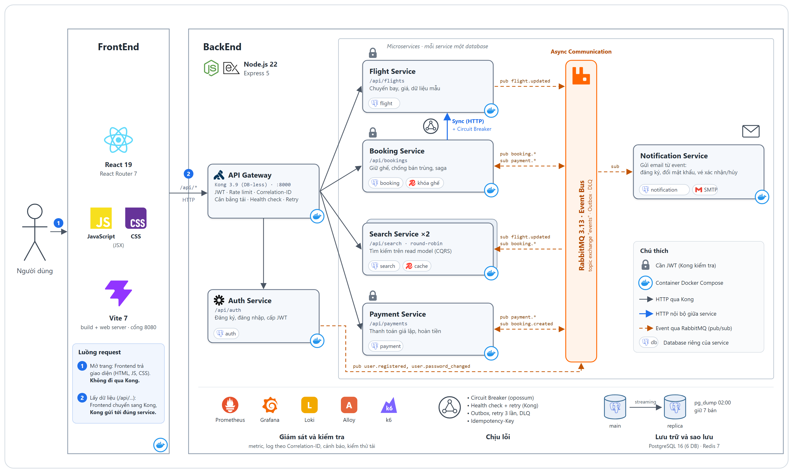

# SkyBook: hệ thống đặt vé máy bay phân tán

Đồ án môn Hệ thống phân tán. SkyBook cho phép tìm chuyến bay, chọn ghế, giữ chỗ, thanh toán và nhận
email xác nhận. Hệ thống gồm 6 microservice Node.js giao tiếp qua RabbitMQ, đứng sau Kong API Gateway,
và chạy toàn bộ bằng Docker Compose.

## Mục lục

- [Kiến trúc](#kiến-trúc)
- [Công nghệ](#công-nghệ)
- [Bắt đầu nhanh](#bắt-đầu-nhanh)
- [Cấu hình](#cấu-hình)
- [API](#api)
- [Event](#event)
- [Kiểm thử](#kiểm-thử)
- [Demo chịu lỗi](#demo-chịu-lỗi)
- [Giám sát](#giám-sát)
- [Gửi email thật](#gửi-email-thật)
- [Sao lưu, khôi phục và failover](#sao-lưu-khôi-phục-và-failover)
- [Cấu trúc thư mục](#cấu-trúc-thư-mục)
- [Phát triển frontend](#phát-triển-frontend)
- [Hạn chế đã biết](#hạn-chế-đã-biết)

## Kiến trúc



```text
Trình duyệt ──► Kong :8000 ─┬─ /            ──► frontend (nginx, file React tĩnh)
                            ├─ /api/auth     ──► auth
                            ├─ /api/flights  ──► flight
                            ├─ /api/search   ──► search-1, search-2 (round-robin)
                            ├─ /api/bookings ──► booking ──HTTP + circuit breaker──► flight
                            └─ /api/payments ──► payment

auth, flight, booking, payment ──outbox──► RabbitMQ (exchange "events") ──► search, booking,
                                                                            payment, notification
Mỗi service có database riêng trên postgres-main ──streaming replication──► postgres-replica
```

| Service | Trách nhiệm | Database | Dùng thêm |
| --- | --- | --- | --- |
| `auth` | Đăng ký, đăng nhập, hồ sơ, ảnh đại diện, đổi mật khẩu, cấp JWT | `auth` | |
| `flight` | Chuyến bay, giá, dữ liệu mẫu 30 ngày | `flight` | |
| `search` (x2) | Tìm kiếm và gợi ý chuyến trên read model (CQRS) | `search` | Redis (cache 15 giây) |
| `booking` | Giữ ghế, chống bán trùng, saga, job hủy vé quá hạn | `booking` | Redis (khóa ghế), gọi `flight` |
| `payment` | Thanh toán giả lập, hoàn tiền | `payment` | |
| `notification` | Gửi email khi có event | `notification` | SMTP (tùy chọn) |

Các cơ chế chính:

- **Kong là lối vào duy nhất.** Kong kiểm tra JWT, giới hạn 6.000 request/phút, gắn `X-Correlation-ID`,
  cân bằng tải và health check cho Search và Booking. Các service kiểm tra JWT lại một lần nữa.
- **Transactional outbox.** Dữ liệu nghiệp vụ và event được ghi trong cùng một transaction. Một tiến
  trình nền đẩy event lên RabbitMQ mỗi 500 ms. Bên nhận ghi lại `event_id` vào `processed_events` để
  bỏ qua event trùng. Event xử lý lỗi được thử lại 3 lần rồi chuyển vào `<queue>.dlq`.
- **Saga đặt vé.** Booking tạo vé ở trạng thái `PENDING` và giữ ghế 10 phút. Kết quả thanh toán chuyển
  vé sang `CONFIRMED` hoặc `CANCELLED`. Hết thời gian giữ thì job tự hủy. Nếu tiền về sau khi vé đã
  bị hủy, Booking phát yêu cầu hoàn tiền.
- **Chống bán trùng ghế qua 3 lớp:** khóa Redis `SET NX`, unique index `uq_active_seat` trong
  PostgreSQL, và header `Idempotency-Key` để gửi lại request không tạo vé thứ hai.
- **Circuit breaker** (opossum) bọc lời gọi từ Booking sang Flight và từ Payment sang cổng thanh toán.
  Khi phụ thuộc gặp sự cố, service trả `503` ngay thay vì chờ timeout.

## Công nghệ

| Lớp | Công nghệ |
| --- | --- |
| Frontend | React 19, React Router 7, Vite 7, phục vụ bằng nginx 1.27 |
| API Gateway | Kong 3.9 (DB-less, cấu hình khai báo) |
| Service | Node.js 22, Express 5, pg, amqplib, redis, opossum, pino, prom-client |
| Dữ liệu | PostgreSQL 16 (primary và replica), Redis 7, RabbitMQ 3.13 |
| Giám sát | Prometheus, Grafana, Loki, Alloy, cAdvisor, các exporter cho Postgres và Redis |
| Kiểm thử | `node --test` (end-to-end), k6 (tải) |

## Bắt đầu nhanh

Yêu cầu:

- Docker Desktop, cấp cho Docker tối thiểu 4 GB RAM
- Node.js 22 (chỉ cần khi chạy test end-to-end)

```bash
docker compose up -d --build
```

Lần đầu build mất vài phút. Khoảng 1 phút sau khi các container chạy, hệ thống có đủ dữ liệu mẫu:
2.880 chuyến bay trong 30 ngày tới, 12 giờ bay mỗi ngày trên 8 chặng. Mỗi lần khởi động, Flight tự bổ
sung các chuyến còn thiếu để lịch bay luôn kéo dài 30 ngày, và không ảnh hưởng tới vé đã đặt.

Kiểm tra trạng thái các container:

```bash
docker compose ps
```

| Trang | Địa chỉ | Tài khoản |
| --- | --- | --- |
| Website và API (qua Kong) | http://localhost:8000 | Tự đăng ký |
| Grafana | http://localhost:3000 | `admin` / `admin` |
| Prometheus | http://localhost:9090 | |
| RabbitMQ Management | http://localhost:15672 | `guest` / `guest` |

Tài khoản quản trị dùng để gọi API tạo và sửa chuyến bay: `admin@flight.local` / `admin123`.

Thanh toán là giả lập: bấm thanh toán trên website luôn thành công. Muốn thử nhánh thất bại, gọi
`POST /api/payments` với `cardNumber` có 4 số cuối là `0000`.

Dừng hệ thống:

```bash
docker compose down        # giữ dữ liệu
docker compose down -v     # xóa luôn dữ liệu trong các volume
```

## Cấu hình

[docker-compose.yml](docker-compose.yml) đã có giá trị mặc định cho môi trường phát triển. Muốn ghi
đè, sao chép [.env.example](.env.example) thành `.env` rồi sửa.

| Biến | Mặc định | Ý nghĩa |
| --- | --- | --- |
| `POSTGRES_PASSWORD` | `postgres` | Mật khẩu PostgreSQL |
| `REPLICATOR_PASSWORD` | `replicator` | Mật khẩu user dùng cho replication |
| `GRAFANA_PASSWORD` | `admin` | Mật khẩu `admin` của Grafana |
| `JWT_SECRET` | `dev-only-change-me-...` | Khóa ký JWT. **Đổi biến này thì phải đổi cả `consumers.jwt_secrets.secret` trong [kong/kong.yml](kong/kong.yml)**, nếu không mọi route cần đăng nhập sẽ trả `401`. |
| `GATEWAY_FAIL_RATE` | `0` | Tỉ lệ từ 0 đến 1 các lần gọi cổng thanh toán giả lập bị lỗi |
| `MAIL_RELAY_HOST` | (trống) | Máy chủ SMTP. Để trống thì không gửi email. |
| `MAIL_RELAY_PORT` | `587` | Cổng SMTP |
| `MAIL_RELAY_USER`, `MAIL_RELAY_PASS` | (trống) | Tài khoản SMTP |

Mọi mật khẩu và `JWT_SECRET` mặc định chỉ dùng cho môi trường phát triển.

## API

Mọi API đi qua Kong tại `http://localhost:8000`. Route có đánh dấu JWT cần header
`Authorization: Bearer <token>`, lấy token từ `POST /api/auth/login`.

| Method | Đường dẫn | JWT | Mô tả |
| --- | --- | --- | --- |
| `POST` | `/api/auth/register` | | Đăng ký |
| `POST` | `/api/auth/login` | | Đăng nhập, trả về JWT |
| `GET`, `PATCH` | `/api/auth/me` | Có | Xem, sửa hồ sơ |
| `PUT`, `DELETE` | `/api/auth/me/avatar` | Có | Đặt, xóa ảnh đại diện |
| `POST` | `/api/auth/me/password` | Có | Đổi mật khẩu |
| `GET` | `/api/flights/:id` | | Chi tiết chuyến bay |
| `POST` | `/api/flights` | Admin | Tạo chuyến bay |
| `PATCH` | `/api/flights/:id` | Admin | Sửa giá, giờ bay |
| `GET` | `/api/search?origin=&destination=&date=&sort=&maxPrice=&airline=` | | Tìm chuyến bay |
| `GET` | `/api/search/suggestions` | | Gợi ý chuyến sắp khởi hành |
| `GET` | `/api/search/airports` | | Danh sách sân bay |
| `POST` | `/api/bookings` | Có | Giữ ghế. Cần header `Idempotency-Key`. |
| `GET` | `/api/bookings` | Có | Danh sách vé của tôi |
| `GET` | `/api/bookings/:id` | Có | Chi tiết vé |
| `GET` | `/api/bookings/flights/:flightId/seats` | Có | Sơ đồ ghế của chuyến bay |
| `POST` | `/api/payments` | Có | Thanh toán cho một booking |
| `GET` | `/api/payments/:bookingId` | Có | Trạng thái thanh toán |

Mỗi service còn có `/health/live`, `/health/ready` và `/metrics`. Các endpoint này chỉ truy cập được
trong mạng Docker, không đi qua Kong.

## Event

Tất cả event đi qua topic exchange `events` của RabbitMQ. Mỗi service nhận event qua queue riêng
`<service>.events`.

| Event | Phát bởi | Nhận bởi |
| --- | --- | --- |
| `user.registered` | Auth | Notification |
| `user.password_changed` | Auth | Notification |
| `flight.updated` | Flight | Search, Booking |
| `booking.created` | Booking | Search, Payment |
| `booking.confirmed` | Booking | Notification |
| `booking.cancelled` | Booking | Search, Notification |
| `payment.succeeded` | Payment | Booking |
| `payment.failed` | Payment | Booking |
| `payment.refund_requested` | Booking | Payment |

## Kiểm thử

Chạy trên hệ thống đang hoạt động:

```bash
# 13 test end-to-end
node --test tests/e2e.mjs

# 100 request cùng tranh một ghế: đúng 1 thành công, 99 nhận 409
docker compose run --rm k6 run /scripts/seat-race.js
```

## Demo chịu lỗi

Mở dashboard "Tổng quan hệ thống đặt vé" trong Grafana, rồi chạy tải:

```bash
docker compose run --rm k6 run /scripts/failover.js
```

Trong lúc tải đang chạy, thử từng sự cố:

| Sự cố | Lệnh | Kết quả mong đợi |
| --- | --- | --- |
| Một instance Search chết | `docker stop search-1`, sau đó `docker start search-1` | Tải chuyển sang `search-2`. Instance tự quay lại trong vòng 45 giây. |
| Redis chết | `docker stop redis` | Search đọc thẳng từ DB, vẫn không bán trùng ghế |
| RabbitMQ chết | `docker stop rabbitmq` | Vẫn đặt được vé. Event được gửi bù khi RabbitMQ chạy lại. |
| Flight chết | `docker stop flight` | Đặt vé trả `503`. Breaker mở nên lỗi trả về ngay, xem ghế vẫn chạy. |
| Cổng thanh toán lỗi | `GATEWAY_FAIL_RATE=1 docker compose up -d --no-deps payment` | Thanh toán trả `503`, booking giữ `PENDING` để thử lại |

Trên PowerShell, đặt biến bằng `$env:GATEWAY_FAIL_RATE = "1"` trước lệnh `docker compose`.

## Giám sát

| Xem gì | Ở đâu |
| --- | --- |
| Sức khỏe, lưu lượng, lỗi, RAM, CPU, log | Grafana: Dashboards > Flight Booking > Tổng quan hệ thống đặt vé |
| Cảnh báo đang bật | Grafana: Alerting > Alert rules |
| Log theo service hoặc correlation ID | Grafana: Explore > Loki, ví dụ `{service="booking"}` |
| Service nào đang được thu metric | Prometheus: Status > Target health |
| Queue, event tồn, dead letter queue | RabbitMQ: tab Queues and Streams |
| Email đã gửi hay bị bỏ qua | `docker compose logs notification`, tìm `email sent` hoặc `email skipped` |

Xem log của một service: `docker compose logs -f booking`.

## Gửi email thật

Mặc định hệ thống không gửi email mà chỉ ghi log `email skipped`. Để gửi tới hộp thư thật cần một
tài khoản Gmail làm người gửi:

1. Bật xác minh 2 bước cho tài khoản Gmail.
2. Tạo App Password tại https://myaccount.google.com/apppasswords.
3. Chạy script cấu hình:

   ```powershell
   powershell -ExecutionPolicy Bypass -File scripts\setup-email.ps1
   ```

   Script lưu cấu hình vào `.env`, khởi động lại Notification và báo Gmail có chấp nhận đăng nhập không.

Trên Linux hoặc macOS: sao chép `.env.example` thành `.env`, điền các biến `MAIL_RELAY_*`, rồi chạy
`docker compose up -d --no-deps notification`.

Lưu ý:

- Địa chỉ có đuôi `.local` luôn bị bỏ qua, kể cả tài khoản test.
- Gửi lỗi thì event được thử lại 3 lần rồi chuyển vào `notification.events.dlq`. Việc đăng ký và đặt
  vé vẫn thành công.
- Hệ thống chưa xác minh email, nên ai cũng có thể đăng ký bằng địa chỉ của người khác.

## Sao lưu, khôi phục và failover

Container `backup` chạy `pg_dump` lúc 00:00 (giờ Việt Nam) hằng ngày và giữ 7 bản gần nhất trong
`backups/`. Docker phải đang chạy vào lúc đó; lần nào bị lỡ sẽ không được chạy bù.

```bash
# Sao lưu ngay
docker compose exec backup sh /scripts/backup.sh

# Khôi phục một database vào database đang làm chính (dừng các service ghi vào DB đó trước)
docker compose exec backup sh /scripts/restore.sh 20261031-020000 booking
```

### Failover và failback

Bình thường `postgres-main` là database chính, `postgres-replica` là bản sao. Việc chuyển đổi làm
bằng tay qua 2 script PowerShell:

```powershell
# postgres-main chết hoặc cần tắt: chuyển hệ thống sang replica (khoảng 20 giây)
powershell -ExecutionPolicy Bypass -File scripts\failover.ps1

# Đưa postgres-main về làm chính, dựng lại replica làm bản sao (khoảng 1 phút)
powershell -ExecutionPolicy Bypass -File scripts\failback.ps1
```

| Script | Các bước |
| --- | --- |
| `failover.ps1` | Dừng service và `postgres-main`, promote replica, ghi `POSTGRES_HOST=postgres-replica` vào `.env`, khởi động lại service và chờ Kong chuyển request được |
| `failback.ps1` | Dừng service, sao lưu dữ liệu mới nhất từ replica, khôi phục vào `postgres-main`, xóa và dựng lại replica từ main, bỏ `POSTGRES_HOST` khỏi `.env`, khởi động lại service |

Sau failover, hệ thống không tự quay về `postgres-main` khi nó sống lại, vì dữ liệu của main đã cũ:
các vé đặt trong lúc chạy trên replica chỉ nằm ở replica. Trong thời gian này không còn bản sao dự
phòng. Chạy `failback.ps1` để chép dữ liệu mới về main và có lại bản sao.

Đang ở trạng thái failover thì không xóa dòng `POSTGRES_HOST` trong `.env` bằng tay, nếu không các
service sẽ quay về dữ liệu cũ của `postgres-main`. Mỗi lần failback tạo thêm một bản sao lưu, tính
vào giới hạn 7 bản.

## Cấu trúc thư mục

```text
.
├── docker-compose.yml     Toàn bộ hệ thống
├── .env.example           Mẫu biến môi trường
├── kong/kong.yml          Route, upstream, health check, JWT, rate limit
├── services/              npm workspace của các service
│   ├── Dockerfile         Dockerfile dùng chung, chọn service qua build arg SERVICE
│   ├── common/            Log, metric, outbox, RabbitMQ, circuit breaker, health, graceful shutdown
│   ├── auth/
│   ├── flight/
│   ├── search/
│   ├── booking/
│   ├── payment/
│   └── notification/
├── frontend/              React + Vite, build thành file tĩnh và phục vụ bằng nginx
├── db/
│   ├── main/              Schema 6 database và cấu hình replication
│   └── replica/           Script khởi động replica
├── monitoring/            Cấu hình Prometheus, Grafana, Alloy
├── scripts/               Sao lưu, khôi phục, failover, failback, cấu hình email
├── k6/                    Kịch bản kiểm thử tải
├── tests/e2e.mjs          Test end-to-end
└── docs/                  Sơ đồ kiến trúc
```

## Phát triển frontend

Chạy Vite dev server để sửa giao diện và thấy thay đổi ngay. Backend vẫn chạy trong Docker; Vite
chuyển `/api` sang Kong tại `localhost:8000`.

```bash
cd frontend
npm install
npm run dev
```

## Hạn chế đã biết

- Kong, Redis, RabbitMQ và Booking chỉ chạy 1 instance. Kong chết thì toàn hệ thống dừng; Booking
  chết thì không đặt được vé.
- Cả 6 database nằm chung container `postgres-main`. Container này chết thì mọi service dừng cho tới
  khi failover xong.
- Failover database chạy bằng script nhưng phải tự gọi, không tự động khi main chết. Chưa có auto-scaling.
- Chỉ chạy HTTP vì là môi trường local. Muốn dùng HTTPS cần thêm chứng chỉ cho Kong.
- Sau khi rebuild một service, Kong có thể trả `503` trong vài giây cho tới khi phân giải được IP mới.
